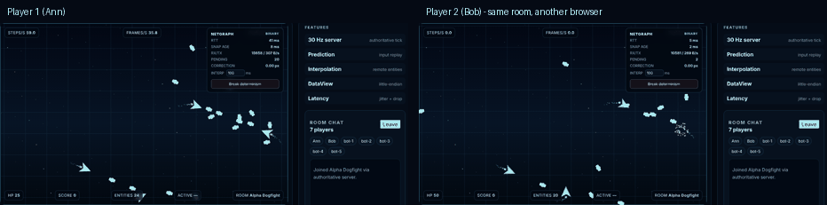
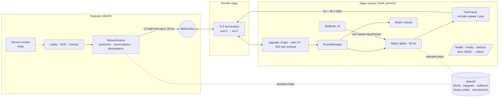
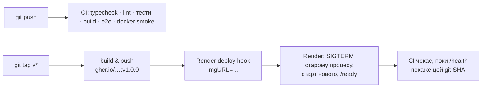
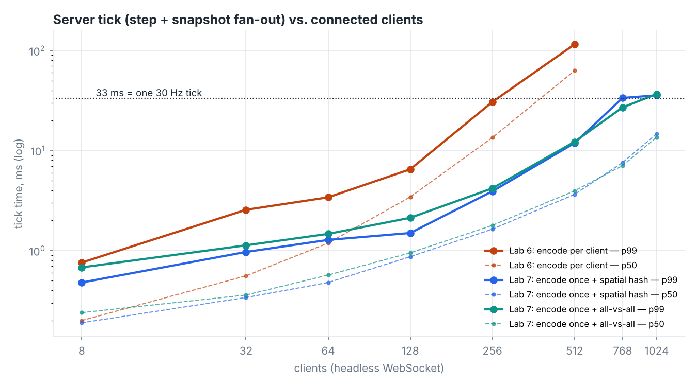

# 🚀 Starship Arena

[](https://github.com/dfsgotl-lenya/starship-arena-lab01/actions/workflows/ci.yml)
[](https://github.com/dfsgotl-lenya/starship-arena-lab01/actions/workflows/deploy.yml)

**Онлайн-шутер у космосі для кількох гравців у браузері.** Авторитетний сервер на Node.js (30 Hz), передбачення й узгодження на клієнті, бінарний протокол, боти, а ще його можна встановити на телефон як застосунок.

### ▶ Грати: **[starship-arena.onrender.com](https://starship-arena.onrender.com)**

> Сервер на безкоштовному тарифі Render: якщо гру ніхто не відкривав 15 хвилин, перший вхід триває ~30–50 с (сервер прокидається). Далі — без затримок.



🎬 **Відео-демо (3–5 хв):** _посилання буде тут — сценарій: [docs/lab8/demo-script.md](docs/lab8/demo-script.md)_

---

## Як грати

1. Відкрийте посилання, введіть ім’я, виберіть кімнату (**Alpha Dogfight** — там завжди літають боти) і натисніть **Join**.
2. Надішліть посилання другу — він потрапить у ту саму кімнату, навіть з іншої мережі чи країни.
3. Керування: <kbd>W</kbd>/<kbd>↑</kbd> — тяга, <kbd>A</kbd>/<kbd>D</kbd> або <kbd>←</kbd>/<kbd>→</kbd> — поворот, <kbd>Space</kbd> — постріл. Астероїд — 10 очок, корабель — 50.
4. **Встановити як застосунок:** у Chrome/Edge — іконка «Встановити» в адресному рядку; на Android — меню ⋮ → «Додати на головний екран»; на iPhone (Safari) — «Поділитися» → «На екран Додому».

Праворуч зверху — netgraph: RTT, вік знімка, трафік, кількість непідтверджених input і поправка передбачення.

## Запуск локально — 3 команди

```bash
npm ci
npm run build
node server/src/index.ts        # http://127.0.0.1:3001  (BOTS=8 node server/src/index.ts — з ботами)
```

Або як у продакшні: `docker compose up --build` → http://localhost:3001.

## Архітектура



- **shared/** — детермінована симуляція (`World.step`, `integrateInPlace`, просторовий хеш, пули) і протокол (бінарний кодек на `DataView`, zod-схеми). Один і той самий код рахує і сервер, і клієнт.
- **server/** — один процес: HTTP (статика, API, health/metrics) + WebSocket. Кімната живе в пам’яті процесу; тік = крок симуляції + розсилка знімка.
- **client/** — Vite + Canvas без фреймворку; передбачення власного корабля, узгодження зі знімками сервера, інтерполяція чужих сутностей.

## Продакшн: що робить процес

| Вимога                   | Як зроблено                                                                                                                                                                                                                                                                                                                                                                                                                                                                             |
| ------------------------ | --------------------------------------------------------------------------------------------------------------------------------------------------------------------------------------------------------------------------------------------------------------------------------------------------------------------------------------------------------------------------------------------------------------------------------------------------------------------------------------- |
| Порт і адреса з оточення | `PORT`, `HOST=0.0.0.0` в образі; Render передає свій `PORT`                                                                                                                                                                                                                                                                                                                                                                                                                             |
| **SIGTERM**              | readiness → 503 → `server.close()` → кожному клієнту `{type:"shutdown"}` + close **1001** → зупинка матчів і flush NDJSON-логів → `exit 0`. Запобіжник: якщо не встигли за `SHUTDOWN_GRACE_MS` (8 с) — лог і `exit 1`. `docker stop` у CI: **125 мс, код 0, клієнт отримав 1001** (див. анотації job `docker` у вкладці Actions)                                                                                                                                                              |
| `/health`                | liveness: `{ ok, version, gitSha, uptime, rssMb }` — відповідає, поки процес живий                                                                                                                                                                                                                                                                                                                                                                                                      |
| `/ready`                 | readiness: 200, поки можна пускати гравців; 503 від моменту SIGTERM                                                                                                                                                                                                                                                                                                                                                                                                                     |
| Необроблений виняток     | `uncaughtException`/`unhandledRejection` → `fatal` зі стеком → `exit 1`, перезапуск робить платформа (перевірено тестом з `/api/debug/crash`, ендпоінт вимкнений за замовчуванням)                                                                                                                                                                                                                                                                                                      |
| Логи                     | **pino**, рядки JSON у stdout, поле `event` (`room.created`, `player.joined`, `ws.rejected`…), `roomId`, `playerId`, `connId`; `LOG_LEVEL`; тексти чату й заголовки авторизації не логуються (`redact`)                                                                                                                                                                                                                                                                                 |
| `/metrics`               | Prometheus (`prom-client`): `starship_players`, `starship_bots`, `starship_rooms`, `starship_ws_connections`, `starship_ws_messages_total{direction}`, `starship_ws_bytes_total{direction}`, `starship_tick_p99_ms{room}`, `starship_tick_step_ms{room}`, `starship_event_loop_utilization`, `starship_ws_rejections_total{reason}`, пам’ять/GC (`starship_process_*`, `starship_nodejs_*`), `starship_build_info{version,git_sha}`. JSON з повідомленнями/с і байтами/с — `/api/stats` |
| Конфіг                   | zod при старті (`server/src/config.ts`): `ALLOWED_ORIGINS`, `MAX_CONNECTIONS_PER_IP`, `MAX_ROOMS`, `MAX_PLAYERS_PER_ROOM`, `TRUST_PROXY`, `LOG_LEVEL`, ліміти з Lab 4. Невалідне значення — процес не стартує. Усі ключі — у `.env.example`                                                                                                                                                                                                                                             |
| Версія                   | `GIT_SHA`/`APP_VERSION` вшиваються в образ (`--build-arg`), видно в `/health`, у `/metrics` і в шапці гри                                                                                                                                                                                                                                                                                                                                                                               |

### Захист від зловживань

- **Origin** перевіряється на рукостисканні, ще до `ws`: дозволено свій origin (той самий host), список `ALLOWED_ORIGINS` і — для ботів/load-test — клієнтів без `Origin`. Інакше **403** і `ws_rejections_total{reason="origin"}`.
- **Ліміт з’єднань з однієї IP** (`MAX_CONNECTIONS_PER_IP`, за проксі — з `X-Forwarded-For` при `TRUST_PROXY=true`) → **429**.
- З Lab 4: `maxPayload`, token bucket на повідомлення, join timeout, slow-client (`bufferedAmount`), heartbeat ping/pong кожні 15 с — він же тримає з’єднання живим крізь idle-timeout проксі Render.

### Хаос-тести

| Сценарій                                                 | Що відбувається                                                                                                                                                                   | Доказ                                                                  |
| -------------------------------------------------------- | --------------------------------------------------------------------------------------------------------------------------------------------------------------------------------- | ---------------------------------------------------------------------- |
| Клієнт зник посеред матчу (TCP обірвано без close frame) | гравця прибрано з кімнати, ростер оновлено                                                                                                                                        | `server/test/production.test.ts`                                       |
| Сервер убито (SIGTERM, як при кожному деплої)            | гравець бачить «Server is restarting…», повертається в лобі; лобі опитує сервер з експоненційною затримкою 0,5→8 с; коли новий процес піднявся — «Server is back», можна заходити | `e2e/server-restart.spec.ts` (Playwright), `client/test/lobby.test.ts` |
| Клієнт шле ~1 000+ битих кадрів/с                        | кожне з’єднання закривається з **1008** на першому битому кадрі, лічильник `bad_binary`; тік інших кімнат не росте                                                                | `node server/scripts/chaos.ts`, таблиця нижче                          |

```text
Chaos: garbage flood into room nebula, 8 bots playing in alpha
                        alpha tick p50   alpha tick p99   event-loop utilization
before flood                 0.22 ms          0.59 ms        0.014
during flood (10 s)          0.17 ms          0.33 ms        0.25
garbage frames: 14 540 in 10 s (≈ 1 454/s); connections cut off with 1008: 1 454
starship_ws_rejections_total{reason="bad_binary"} 1454
```

Зайнятість циклу подій зросла з 1 % до 25 % (сервер справді працював — приймав і рвав 145 з’єднань/с), але p99 тіку кімнати _alpha_ не виріс: розбір повідомлень і тік — різні задачі в черзі подій, і жодна не блокує іншу надовго.

## Docker і доставка

- **Dockerfile** у три етапи: `build` (усі залежності, `vite build`) → `deps` (`npm ci --omit=dev` лише для `server` і `shared`) → `runtime` на `node:24-alpine`: без dev-залежностей, без npm/yarn, **користувач `node`**, `HEALTHCHECK` на `/health`, `CMD ["node", "server/src/index.ts"]` — exec-форма, тож SIGTERM від `docker stop` іде прямо в Node (з `npm start` між ними стояв би npm, який сигнал не передає). Сервер запускається з TypeScript через вбудоване в Node видалення типів — без `tsx` і без збірки.
- **Розмір образу: 172 МБ** (< 200 МБ; перевіряється в CI скриптом `scripts/docker-smoke.sh`).
- `package*.json` копіюються раніше за код: шар `npm ci` береться з кешу, доки не зміниться залежність.



`.github/workflows/deploy.yml`: тег `v*` → образ у **GitHub Container Registry** → **Render** deploy hook → перевірка, що живий `/health` повертає SHA цього коміту. Секрет `RENDER_DEPLOY_HOOK_URL` і змінна `PUBLIC_URL` — у налаштуваннях репозиторію, не в коді.

**Моніторинг:** UptimeRobot перевіряє `https://starship-arena.onrender.com/health` кожні 5 хв і пише на пошту, якщо сервер не відповідає (заодно не дає безкоштовному інстансу заснути).

## Виміряно за семестр

### Протокол: JSON vs бінарний (Lab 5, `npm run bench:codec`)

| Кодек                 | Байт на знімок | КБ/с вниз (30 Hz) | Байт на input | КБ/с вгору | encode+decode |
| --------------------- | -------------: | ----------------: | ------------: | ---------: | ------------: |
| JSON                  |          1 885 |              55,2 |            77 |       2,26 |      32,5 мкс |
| Бінарний (`DataView`) |        **432** |          **12,7** |        **12** |   **0,35** |   **6,4 мкс** |

### Пам’ять і кадр (Lab 7, 30 с, 8 ботів, headless Chromium)

|                                      |                            До |               Після |
| ------------------------------------ | ----------------------------: | ------------------: |
| Виділено пам’яті                     |            614 МБ (20,5 МБ/с) | **6 МБ (0,2 МБ/с)** |
| Minor GC: кількість / найдовша пауза |                  24 / 25,2 мс |      **3 / 1,5 мс** |
| Робота кадру p99                     |                        4,2 мс |     4,7 мс (< 16,7) |
| Топ-алокатор                         | потрійна zod-валідація знімка |                   — |

Деталі, flame chart і висновок про Web Worker — [docs/lab7/REPORT.md](docs/lab7/REPORT.md).

### Скільки гравців тримає один процес



Два виміри (`npm run perf:load`, 2 vCPU, генератор навантаження на тій самій машині):

| Сценарій                                                    | 64 гравці |  256 |  512 |      768 |    1 024 |
| ----------------------------------------------------------- | --------: | ---: | ---: | -------: | -------: |
| **Кімнати по 8** (як у реальній грі): найгірший тік p99, мс |       2,7 |  1,1 |  1,8 |      3,9 |      5,4 |
| └ тіків/с (має бути 30)                                     |      30,0 | 30,0 | 30,1 | **24,8** | **14,4** |
| **Усі в одній кімнаті**: тік p99, мс                        |       1,3 |  3,9 | 11,9 | **33,6** | **35,7** |

**Ємність одного процесу: ≈ 512 гравців (64 кімнати по 8)**; з 768 процес уже не тримає 30 Hz. Вузьке місце — **розсилка знімків і обробка вхідних повідомлень** (сотні `socket.send`/`message` за тік на одне ядро), а не фізика: крок симуляції кімнати — 0,05 мс, і навіть кімната на 1 024 гравці рахує крок за ~4 мс. На безкоштовному інстансі Render (0,1 CPU) це в ~10–20 разів менше — **оцінка ≈ 25–50 гравців**; для курсу більш ніж досить, але це перше, що впирається при зростанні.

### Справжній RTT: двоє гравців не з моєї мережі

| Гравець          | Місто / мережа                                | RTT (netgraph), мс | Snapshot age, мс | Correction, px |
| ---------------- | --------------------------------------------- | -----------------: | ---------------: | -------------: |
| Автор (контроль) | Україна, домашній інтернет → Render Frankfurt | 38–46 (медіана 39) |             2–33 |      0,00–0,08 |
| Гравець A        | _заповнити після гри_                         |                    |                  |                |
| Гравець B        | _заповнити після гри_                         |                    |                  |                |

Як виміряти: кожен гравець відкриває гру, хвилину грає в _Alpha Dogfight_ і переписує з netgraph RTT, SNAP AGE і CORRECTION (або надсилає скріншот). Snapshot age 0–33 мс — це фаза 30 Hz тіку; correction ≈ 0 означає, що передбачення збігається з сервером.

## Обмеження (і чому вони є)

- **Один інстанс.** Кімната — це стан у пам’яті одного процесу; два інстанси за round-robin розділили б гравців однієї кімнати. Для навчального проєкту одного процесу досить (див. ємність вище).
- **Холодний старт ~30–50 с** на безкоштовному Render, якщо 15 хв ніхто не грав; uptime-монітор це пом’якшує.
- **Немає lag compensation**: влучання рахується на сервері в його часі, тож при RTT 150+ мс доводиться «стріляти на випередження».
- **Інтерполяція 100 мс**: чужі кораблі показуються на ~100 мс у минулому — плата за плавність при jitter.
- **Немає акаунтів і матчмейкінгу**: ім’я — просто рядок, кімнати фіксовані + створені через API.
- **Без Origin бот/скрипт усе одно може підключитися** (Origin захищає браузерних користувачів, не сервер); від скриптів — ліміти з’єднань, повідомлень і розміру.

## Що я зробив би далі

1. **Кілька інстансів зі sticky routing за id кімнати** (Fly regions або nginx/Caddy `hash $room`), а для кімнат «на кількох серверах» — **Redis pub/sub**.
2. **Lag compensation**: сервер «відмотує» світ на RTT стрілка при перевірці влучання.
3. **Дельта-знімки та interest management** — розсилка зараз головне вузьке місце.
4. Матчмейкінг і акаунти; Sentry для помилок; itch.io-сторінка.

## Reflection (Lab 8)

1. **Від SIGTERM до виходу:** `/ready` → 503 і нові рукостискання → 503; `server.close()` (нові TCP не приймаються, активні запити дограють); кожному гравцю `shutdown` + close 1001; чекаємо закриття сокетів (до 4 с), решту `terminate`; `roomManager.closeAll()` зупиняє матчі й дописує NDJSON; `logger.flush()`; `exit 0`. З `CMD npm start` PID 1 — npm, він не пересилає SIGTERM дитині; через 10 с Docker шле SIGKILL, і всі гравці отримують обірване з’єднання (1006) без пояснення, а логи не дописуються. Ігнорування SIGTERM дає те саме: кожен деплой = обрив матчу.
2. **Горизонтальне масштабування.** REST без стану — будь-який запит на будь-який інстанс. WebSocket — довге з’єднання зі станом кімнати в пам’яті; гравці однієї кімнати мусять бути в одному процесі. **Sticky sessions:** балансувальник маршрутизує за id кімнати (consistent hash) на фіксований інстанс. **Redis pub/sub:** кожен інстанс тримає своїх гравців, а події кімнати (input, знімки) публікуються в канал кімнати, і авторитетний «власник» кімнати рахує крок. Я зробив **один інстанс**: найпростіше і правильне для очікуваного навантаження; межа задокументована.
3. **wss://** обов’язковий, бо сторінка відкрита по https, а браузер блокує незахищений `ws://` зі сторінки https (mixed content), і без TLS трафік видно і можна підмінити. TLS завершується на edge-проксі Render; до процесу йде звичайний `ws://` з `X-Forwarded-*`. Тому проксі має підтримувати `Upgrade` і не рвати тихі з’єднання — наш ping кожні 15 с робить з’єднання «не тихим».
4. **CORS не діє на WebSocket:** будь-яка сторінка може відкрити сокет до нас від імені свого відвідувача. Зупиняє це перевірка заголовка `Origin` на рукостисканні (браузер його не дає підробити) — у нас в обробнику `upgrade` до `wss.handleUpgrade`.
5. **Liveness** (`/health`): «процес живий?» — якщо ні, платформа його **перезапускає**. **Readiness** (`/ready`): «можна слати трафік?» — якщо ні, платформа **не направляє нових користувачів**, але не вбиває процес (під час старту, зупинки, деплою).
6. **JSON у stdout:** платформа сама збирає stdout, а JSON можна фільтрувати (`event=ws.rejected roomId=alpha`) і рахувати, без парсингу тексту; файли в контейнері зникають разом із ним. pino форматує й пише асинхронно (і може винести транспорт у worker thread), щоб логування не блокувало цикл подій — урок Lab 4 про блокування event loop і backpressure стрімів.
7. **Багатоетапна збірка:** у першому етапі — dev-залежності (Vite, TypeScript, Vitest, Playwright), вихідники клієнта, кеш npm; у фінальному їх бути не повинно: розмір, поверхня атаки, швидкість деплою. `package*.json` копіюються раніше за код, щоб шар `npm ci` брався з кешу, коли змінився лише код.
8. **N і RTT разом:** один процес тримає ≈ 512 гравців (64 кімнати по 8) на 2 vCPU, на 0,1 CPU Render — оцінка 25–50. При RTT ~40 мс (Україна → Франкфурт) гра грається комфортно (предикція ховає RTT для свого корабля, інтерполяція — 100 мс для чужих). Першим я б змінив тариф/CPU і додав дельта-знімки, бо розсилка — вузьке місце.
9. **Падіння о 3-й ночі:** дізнаюся від UptimeRobot (лист: `/health` не відповідає) і з Render (restart events). Дивлюся спершу логи `level=fatal` / `event=process.crash` (там стек), потім `/metrics`: `ws_rejections_total`, `event_loop_utilization`, пам’ять, `tick_p99_ms` перед падінням.

## Історія тегів

| Тег                    | Що додано                                                                                                   |
| ---------------------- | ----------------------------------------------------------------------------------------------------------- |
| `lab-01`               | Canvas, ігровий цикл з фіксованим кроком, корабель і астероїди                                              |
| `lab-02`               | Сутності, колізії, асети, звук, події                                                                       |
| `lab-03`               | Асинхронність: завантаження асетів, retry/backoff, AbortController, lobby                                   |
| `lab-04`               | Node-сервер, кімнати, WebSocket, стріми, NDJSON-логи                                                        |
| `lab-05`               | Авторитетний сервер 30 Hz, prediction/reconciliation, бінарний протокол                                     |
| `lab-06`               | TypeScript, shared/, zod-протокол, детермінована симуляція                                                  |
| `lab-07`               | Vitest/fast-check/Playwright, CI, пули, профілювання, навантаження                                          |
| `lab-08`, **`v1.0.0`** | Docker, graceful shutdown, health/ready, pino, Prometheus, Origin/IP-ліміти, хаос-тести, GHCR → Render, PWA |

Звіти попередніх лаб: [Lab 7](docs/lab7/REPORT.md) · [Lab 6 і раніше](docs/LAB06-and-earlier.md) · [сценарій відео-демо](docs/lab8/demo-script.md)
