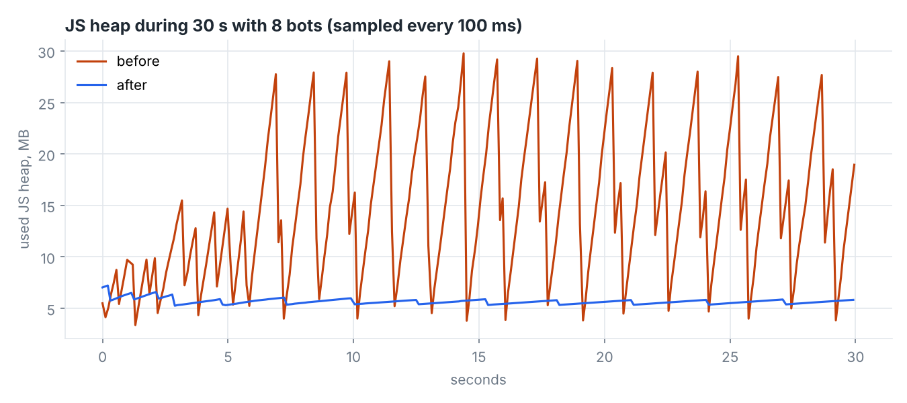
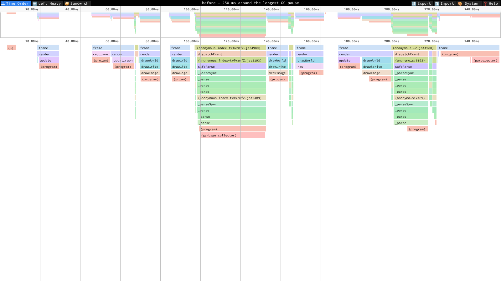
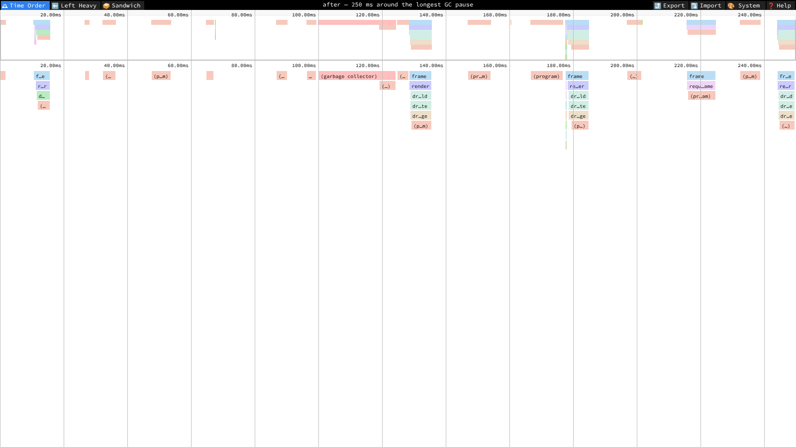

# Lab 07 — V8, пам’ять і тести

[](https://github.com/dfsgotl-lenya/starship-arena-lab01/actions/workflows/ci.yml)

## Starship Arena

Гра з Lab 6 (authoritative server 30 Hz + prediction/reconciliation) тепер покрита тестами, має CI, серверних ботів, пул об’єктів, просторовий хеш і виміряні до/після профілі. Ціль лаби — у грі з 8 ботами немає довгої паузи GC і p99 кадру < 16,7 мс — досягнута (p99 роботи кадру **4,7 мс**, найдовша мала GC-пауза **1,5 мс** замість 25 мс).

## Як запустити

```bash
npm ci
cp .env.example .env          # BOTS=8 — щоб у кімнаті alpha літали боти
npm run build && npm start    # http://127.0.0.1:3001
npm run dev:client            # або Vite dev server на :5173

npm run typecheck && npm run lint
npm test                      # 154 тести (Vitest: shared + server + client)
npm run test:coverage         # покриття, shared/ має бути ≥ 85 %
npm run test:e2e              # Playwright: два браузери в одній кімнаті

npm run build:perf && npm run perf:record -- after   # 30 с з 8 ботами → perf/results/after
npm run perf:load -- after                           # 8…1024 headless-клієнтів → perf/load/after.json
npm run perf:charts                                  # графіки в docs/lab7/
```

Ботів можна додати і в запущений сервер: `POST /api/rooms/alpha/bots?count=8`, прибрати — `DELETE /api/rooms/alpha/bots`.

## Тести

| Пакет     | Файли                                                                                                       | Що перевіряється                                                                                                                                                                                                                                                                                                          |
| --------- | ----------------------------------------------------------------------------------------------------------- | ------------------------------------------------------------------------------------------------------------------------------------------------------------------------------------------------------------------------------------------------------------------------------------------------------------------------- |
| `shared/` | `vector`, `integrate`, `collision`, `world`, `codec`, `protocol`, `pool`, `prng`, `reconcile`, `properties` | вектор; integrate (тяга, поворот, обгортання кута, ліміт швидкості, cooldown, **біт-у-біт збіг зі старою Vector2-версією**); колізії (hit/explode/respawn, «куля не б’є свого», **hash ≡ naive**); **детермінізм кроку** (600 тиків, однакові seed+input → однаковий стан); бінарний кодек і протокол; пул                |
| `server/` | `match`, `ws`, `bots`, `rate-limit`, `config`, Lab 5 тести                                                  | ігровий цикл на **фейкових таймерах** (рівно 30 тиків/с без дрейфу, stop, порядок input, відкидання старих/занадто нових seq, один encode на тік); **ліміт частоти** (TokenBucket на фейковому годиннику + flood через справжній WebSocket → 1008); битий бінарний кадр закриває лише цей сокет, сервер працює далі; боти |
| `client/` | `loop`, `game-client`, `connection`, `particles`, `misc`                                                    | цикл на фейкових `requestAnimationFrame`/`performance` (60 кроків/с, затискання 2-секундного фрізу до 0,25 с); **звірка з сервером**: клієнт передбачає, справжній `World` рахує, correction < 0,05 px; reconciliation, згладжування, інтерполяція, кільце знімків, рендер без нових об’єктів                             |

**fast-check (9 властивостей, `shared/test/properties.test.ts`):**

1. `decodeInput(encodeInput(x))` — те саме повідомлення.
2. Знімок після кодування/декодування — той самий з урахуванням `Math.fround` і **округлення кута до 1/1000 рад** (|Δ| ≤ 0,0005).
3. Довжина кадру = 12 байт для input і **16 + 26·n** для знімка (і `entityCount` у заголовку = n).
4. Випадкові байти та кадри з одним зіпсованим байтом → або коректне повідомлення зі скінченними числами, або `Error`, **ніколи не падіння**.
5. Корабель після будь-якої послідовності input лишається в арені `[0, w) × [0, h)`.
6. `parseClientMessage` приймає будь-яке валідне повідомлення і відхиляє зіпсоване (без `v`, `v: 7`, невідомий `type`, обрізаний JSON).
7. `parseClientMessage` ніколи не кидає, що б не прийшло з сокета.
8. Просторовий хеш і all-vs-all дають ідентичні світи й події.
9. Крок детермінований для будь-якого seed і сценарію input.

Разом **154 тести**, покриття `shared/`: **98 % рядків / 92 % гілок** (поріг 85 % зашитий у `vitest.config.ts`, CI падає нижче).

**Playwright** (`e2e/two-players.spec.ts`): два ізольовані browser context заходять у кімнату _alpha_; обидва бачать один одного в ростері; перший тримає `W`, другий бачить, що його корабель зрушив > 40 px; повідомлення з чату першого з’являється у другого рівно один раз.

**CI** (`.github/workflows/ci.yml`, кожен push): `typecheck` → `lint` (typescript-eslint, `no-floating-promises`, `no-misused-promises`) → тести з покриттям → `build` → окремий job з Playwright.

## Запис гри: 30 секунд, 8 ботів — до і після

Скрипт `scripts/perf/record-game.mjs` піднімає сервер з `BOTS=8`, відкриває Chromium через Playwright, заходить у кімнату як «людина» (тримає W+D, стріляє кожні 250 мс) і робить два проходи по 30 с:

- **чистий** — час кадру з `window.__perf` (Float64Array-кільце, `performance.mark/measure` при `?perf=1`) + Chrome trace для пауз GC (`MinorGC`/`MajorGC`);
- **профілювальний** — CPU profile (flame chart) і sampling heap profiler з `includeObjectsCollectedByMinor/MajorGC` — тобто _усі_ виділення, а не лише ті, що вижили.

«Робота кадру» — час від початку rAF-колбеку до кінця рендеру (саме це обмежено бюджетом 16,7 мс). «Інтервал» — відстань між кадрами (60 Hz ⇒ 16,7 мс; більше — пропущений vsync). Вимірювання в headless Chromium 141, програмний рендер, 2 vCPU.

| Метрика                                            |                До (Lab 6) |           Після (Lab 7) |
| -------------------------------------------------- | ------------------------: | ----------------------: |
| робота кадру p50 / p95 / **p99**                   |    0,7 / 2,0 / **4,2** мс |  0,6 / 2,4 / **4,7** мс |
| робота кадру max                                   |                    8,6 мс |                 10,0 мс |
| інтервал кадру p95 / p99 / max                     |     20,0 / 26,9 / 45,9 мс |   19,0 / 23,8 / 39,1 мс |
| кадрів > 20,7 мс (пропущений vsync)                |                        73 |                      48 |
| **виділено пам’яті за 30 с**                       |  **614 МБ (≈ 20,5 МБ/с)** |   **6 МБ (≈ 0,2 МБ/с)** |
| Minor GC (scavenge): кількість / сумарно / **max** | 24 / 339 мс / **25,2 мс** | 3 / 3,6 мс / **1,5 мс** |
| Major GC: кількість / сумарно / max                |     21 / 119 мс / 10,9 мс |    10 / 64 мс / 13,8 мс |
| JS heap (min–max)                                  |       3,4–29,8 МБ (пилка) |      5,3–7,2 МБ (рівно) |
| сервер: тік p50 / p99                              |            0,33 / 1,23 мс |          0,24 / 0,60 мс |



### Хто створював найбільше об’єктів (sampling heap profiler)

| До                                                    | МБ/30 с | частка |     | Після                                                        | МБ/30 с | частка |
| ----------------------------------------------------- | ------: | -----: | --- | ------------------------------------------------------------ | ------: | -----: |
| `ZodObject._parse` (валідація знімка)                 |   231,9 | 37,8 % |     | `drawBackground` (боксування double для `globalAlpha` зірок) |    1,49 |   25 % |
| `ZodEffects._parse` (brand-трансформи id/tick)        |   145,5 | 23,7 % |     | `ParticleSystem.draw` (те саме для `fillRect`)               |    0,87 |   15 % |
| `Array.push` (масиви знімків/рендеру)                 |    41,5 |  6,8 % |     | ітератори `for…of` у Canvas API                              |    0,78 |   13 % |
| `NetworkGame.render` (spread `{...entity}` щокадру)   |    32,5 |  5,3 % |     | `frame`                                                      |    0,33 |  5,5 % |
| `ZodNumber._parse`                                    |    29,1 |  4,7 % |     | `getFloat32`                                                 |    0,31 |  5,1 % |
| `interpolateSnapshots` (`.map` + новий `Map` щокадру) |    28,2 |  4,6 % |     |                                                              |         |        |
| `ZodDiscriminatedUnion._parse`                        |    26,8 |  4,4 % |     |                                                              |         |        |
| `decodeSnapshot` (нові об’єкти на кожен знімок)       |    20,4 |  3,3 % |     |                                                              |         |        |

### Flame chart

До — 250 мс навколо найдовшої паузи GC. Обробник WebSocket → `dispatchEvent` → `safeParse` → `_parse` ×10 рівнів, і **33 мс garbage collector** посеред цього:



Після — у тому самому вікні кадри складаються лише з `frame → render → drawWorld → drawImage`; zod зник з гарячого шляху. Залишкова пауза — це major GC (`finalize incremental marking via task`), який V8/Blink запускає між кадрами, а не всередині:



Агреговані (left-heavy) графи: [до](docs/lab7/flame-before-left-heavy.png), [після](docs/lab7/flame-after-left-heavy.png). Сирі профілі: `perf/results/*/cpu.cpuprofile` (відкриваються в Chrome DevTools → Performance → Load profile або на speedscope.app).

### Що змінено (і чому — за вимірюванням)

1. **Валідація знімка один раз, а не тричі.** Бінарний знімок валідував `decodeSnapshot`, потім ще раз `ServerMessageSchema` у `GameConnection`, потім ще раз у `NetworkGame` і в `main.ts`. Тепер бінарний кадр перевіряє лише декодер (версія, тип, точна довжина, `kind`, флаги, скінченні float), JSON — один раз zod у `GameConnection`; слухачі читають уже провалідоване через `messageOf()` (`WeakSet` провалідованих об’єктів). Це був топ-алокатор: −62 %.
2. **Знімки декодуються в пул.** `decodeSnapshotInto()` пише в кільце з 14 `PooledSnapshot`, у кожного масив `NetEntity` **однієї форми** (усі поля є з народження — один hidden class, мономорфні inline cache у рендері). Пошук за id — `Uint16Array(65536)` замість `Map`.
3. **Рендер без нових об’єктів.** `NetworkGame.render()` повертає той самий масив і ті самі `RenderEntity`; інтерполяція пише в них поля. `renderPos()` у `draw.ts` повертає scratch-об’єкт; градієнт фону кешується.
4. **Без нового вектора в циклі.** `integrateInPlace()` рахує на числах і пише в той самий корабель; порядок операцій з плаваючою комою як у Vector2-версії, тому результат **біт-у-біт однаковий** (є тест). Предикція й reconciliation працюють на 4 заздалегідь створених `ShipEntity`.
5. **Кулі й частинки з пулу.** `Pool<T>` (`shared/sim/pool.ts`): серверні кулі в `World.bulletPool`, передбачені кулі клієнта, вхідні пакети і частинки (`ParticleSystem`, 1024 штуки створюються під час завантаження).
6. **Знахідка V8: `array.length = 0` + `push()` виділяє пам’ять щоразу.** Після перших змін профілятор досі показував 2 МБ/30 с у `#interpolate`. Мікробенчмарк (`--trace-gc`): 200 000 разів «обнулити й заповнити 70 елементів» → **125 scavenge**, а «писати за індексом і лише обрізати в кінці» → **8**. V8 при `length = 0` віддає backing store і `push` росте з нуля. Тепер список рендеру, частинки, просторовий хеш і колізії тримають окремий лічильник.
7. **HUD і netgraph оновлюються 4 рази на секунду**, а не щокадру (рядки + DOM).

Попутно виправлено баги Lab 6, знайдені тестами: власний корабель ніколи не передбачався (`NetworkGame` створювався _після_ події `joined` і не отримував `shipId`); чат показувався двічі; кімната `alpha` зникала, коли з неї виходив останній гравець; `break` замість `continue` у колізіях пропускав цілі; `nextId` переповнював `uint16` після ~65 тис. куль.

**Чесно про major GC.** Повних збирань стало вдвічі менше, але їхні паузи (до 14 мс) не зникли: купа ~3 МБ, а V8 запускає «finalize incremental marking via task» по таймеру/тиску з боку Blink (DOM, WebSocket-повідомлення, `ArrayBuffer` кожні 33 мс) — це не JS-алокації гри. Пауза потрапляє між кадрами, тому p99 _роботи_ кадру < 16,7 мс; у звичайному (не headless, з GPU) Chrome на ноутбуці вона в кілька разів коротша.

## Web Worker: експеримент і рішення

У Worker винесено **валідацію і декодування знімка** (`client/src/netcode/snapshot.worker.ts`): головний потік передає отриманий `ArrayBuffer` _transfer_-ом (без копіювання), Worker декодує і повертає `Float64Array` теж transfer-ом, головний потік розпаковує в пул. Вмикається `?worker=1`.

|                                | Головний потік на 1 знімок | Minor GC за 30 с | p99 роботи кадру |
| ------------------------------ | -------------------------: | ---------------: | ---------------: |
| декодування в головному потоці |                 **73 мкс** |                3 |           4,7 мс |
| Worker (`?worker=1`)           |                    183 мкс |               27 |           4,5 мс |

**Висновок: Worker не залишаємо.** Головний потік не став швидшим — навпаки: `postMessage` двічі + `MessageEvent` + розпакування дорожчі, ніж просто прочитати 26 байт на сутність через `DataView`, і кожне повідомлення створює об’єкти, тому малих GC у 9 разів більше. Після прибирання zod декодування коштує десятки мікросекунд — переносити нема чого. Worker мав би сенс для важкої роботи (pathfinding ботів, фізика сотень тіл, стиснення), а не для дешевого парсингу. Код лишився лише як вимкнений за замовчуванням експеримент.

## Навантаження: від скількох клієнтів крок > 33 мс

`server/scripts/load-test.ts` для кожної кількості запускає новий сервер, створює кімнату потрібної місткості й підключає N **headless WebSocket-клієнтів** (без браузера), які шлють ті самі 12-байтні input 30 разів на секунду. Тік = крок симуляції + розсилка знімків усім.


| клієнти |         Lab 6 тік p50 / p99 | Lab 7 (hash) тік p50 / p99 | Lab 7 тіків/с | Lab 7 (all-vs-all) p99 |
| ------: | --------------------------: | -------------------------: | ------------: | ---------------------: |
|       8 |                 0,20 / 0,76 |                0,19 / 0,48 |          30,0 |                   0,68 |
|      32 |                 0,56 / 2,56 |                0,34 / 0,97 |          30,0 |                   1,13 |
|      64 |                 1,19 / 3,41 |                0,48 / 1,28 |          30,1 |                   1,47 |
|     128 |                 3,44 / 6,51 |                0,87 / 1,50 |          30,0 |                   2,13 |
|     256 |                 13,5 / 30,7 |                1,64 / 3,92 |          30,2 |                   4,20 |
|     512 | **62,9 / 115** (10 тіків/с) |                3,65 / 11,9 |          30,1 |                   12,2 |
|     768 |                           — |            7,59 / **33,6** |      **23,9** |                   27,1 |
|    1024 |                           — |            14,7 / **35,7** |      **16,4** |                   36,8 |

**Відповідь:** у Lab 6 крок перевищував 33 мс між **256 і 512** клієнтами (на 512 сервер падав до 10 тіків/с). У Lab 7 — з **~768** клієнтів (p99 > 33 мс і сервер уже не тримає 30 Hz).

**Що обмежувало і звідки я це знаю.** `step ms` (лише симуляція) навіть на 1024 клієнтах — 4 мс, отже тік з’їдає **розсилка**: у Lab 6 кожному клієнту окремо кодувався знімок (O(N²) записів у `DataView`). Тепер знімок кодується **один раз на тік** (`TickFrame`), а кожен гравець отримує копію з 8 перезаписаними байтами заголовка (`withSnapshotHeader`) — це дало ×5–10. Просторовий хеш замість all-vs-all майже нічого не змінив (колонки hash і all-vs-all близькі): перевірка колізій не була вузьким місцем, бо ціль — лише кулі × (кораблі + астероїди). Хеш лишаємо — він зменшує кількість перевірок пар у > 5 разів (тест) і ростиме у вигоді, коли куль стане більше. На 768+ клієнтах генератор навантаження і сервер ділять ті самі 2 ядра, тож реальна межа на окремій машині вища.

## Reflection

1. **Конвеєр V8.** Джерело → парсер (лінивий: тіла функцій парсяться при першому виклику) → AST → **Ignition** (байткод + feedback vector) → **Sparkplug** (baseline: байткод → машинний код без оптимізацій) → **Maglev** (середній рівень) → **TurboFan** (спекулятивна оптимізація за зібраним feedback). Оптимізацію запускає «гарячість» (лічильник викликів/циклів) + стабільний feedback. **Деоптимізація** — коли спекуляція порушена: інша форма об’єкта (map check), не той тип (Smi → double, рядок замість числа), вихід за межі масиву, `arguments`/`delete`. Тоді код повертається в Ignition, feedback оновлюється і функцію можуть оптимізувати знову (`--trace-opt --trace-deopt` — так я перевірив, що `#interpolate` і `render` в TurboFan і не деоптимізуються).
2. **Hidden class** (map/shape) — опис набору полів і їх зміщень, спільний для об’єктів, створених однаково. Inline cache запам’ятовує для кожного місця доступу map → зміщення. 1 форма — мономорфний (найшвидше), 2–4 — поліморфний (перебір), >4 — мегаморфний (глобальний кеш/хеш-таблиця). Тому `NetEntity`/`RenderEntity` мають однакові поля для всіх видів сутностей, і всі поля задаються одразу в літералі.
3. **Generational GC.** Молоде покоління (semi-space, scavenger) збирається часто й дешево — ціна пропорційна _живим_ об’єктам. Хто пережив два scavenge — переїжджає в старе покоління (mark-compact, інкрементальне/конкурентне маркування). Довгоживучі об’єкти погані двічі: їх копіюють при promotion, а потім вони роздувають старе покоління, і major GC доводиться обходити їх усіх. Плюс write barrier/remembered set для посилань старе → нове.
4. **Топ-алокатор** — zod `_parse` (62 % усіх байтів) через потрійну валідацію кожного знімка; рішення — валідувати один раз на межі довіри, а бінарний кадр перевіряти декодером. Далі — пули й перевикористання. **Ціна пулу:** пам’ять тримається завжди (і стає старим поколінням), треба вручну повертати об’єкти (забув `release` — витік, повернув зарано — use-after-free логіка: об’єкт змінюється під ногами), потрібен reset стану, складніший код і тести. Тому пул — тільки там, де профілятор показав алокації в гарячому циклі.
5. **Typed arrays** зберігають «голі» числа підряд у пам’яті: без боксування double (`HeapNumber`), без hidden class, без вказівників для GC, кеш-дружньо, можна передати transfer-ом у Worker. Втрачаємо: фіксований тип і розмір, немає полів з іменами (індекси замість `entity.x`), рядки/булеві треба кодувати вручну, гірша читабельність. Я використав їх для кільця часу кадру, індексу id → сутність і просторового хешу.
6. **Передача даних у Worker:** (а) **structured clone** — копія будь-якого графа об’єктів, просто, але O(розміру) і алокації з обох боків; (б) **transfer** `ArrayBuffer` — без копіювання, але відправник втрачає буфер; (в) **SharedArrayBuffer + Atomics** — спільна пам’ять без пересилання, але потрібні COOP/COEP-заголовки, синхронізація і ризик гонок. Я використав transfer — і все одно головний потік програв (див. таблицю).
7. **Property-based тест** кращий, коли є інваріант для всього простору входів (round-trip кодека, «корабель в арені», «hash ≡ naive», «парсер не кидає») — він знаходить крайні випадки, яких я б не вигадав (NaN, `-0`, 65535, порожній масив). Приклад-тест кращий для конкретної поведінки й регресій. **Shrinking:** знайшовши падіння, fast-check зменшує вхід (коротші масиви, менші числа), поки тест ще падає, і показує мінімальний контрприклад — + seed для відтворення.
8. **`no-floating-promises` на сервері:** проміс без `await`/`catch` при відхиленні дає `unhandledRejection`, а з Node 15 це **падіння процесу** для всіх кімнат; крім того, помилка губиться і порядок операцій стає непередбачуваним. Лінтер знайшов таке в `createServer(async …)` і обробниках кліків — тепер там явний `void handle()` з try/catch усередині.
9. **Що обмежило навантаження:** розсилка знімків (encode + `socket.send` на кожного клієнта), а не симуляція — це видно з того, що `step ms` ≪ `tick ms` у кожному рядку, а після «encode once» тік упав у 5–10 разів при тому ж кроці. Далі обмеження — CPU (генератор і сервер на одній 2-ядерній машині) і обсяг трафіку (~280 КБ/с на клієнта на 512 гравцях → потрібні interest management/дельта-знімки).

## Структура (нове в Lab 7)

```text
shared/sim/pool.ts            # Pool<T>
shared/sim/spatial-hash.ts    # uniform grid, без алокацій
shared/sim/collision.ts       # CollisionSystem: hash | naive
shared/sim/integrate.ts       # integrateInPlace, copyShip, wrapPosition
shared/codec/binary.ts        # decodeSnapshotInto, withSnapshotHeader, NetEntity
server/src/bots.ts            # BotBrain: snapshot → InputPacket (як у людини)
server/scripts/load-test.ts   # 8…1024 headless-клієнтів
client/src/perf.ts            # FrameRecorder, window.__perf
client/src/render/particles.ts
client/src/netcode/snapshot.worker.ts, snapshot-pack.ts   # експеримент (вимкнено)
scripts/perf/record-game.mjs  # 30 с, 8 ботів: кадри, GC, CPU і heap профілі
scripts/perf/charts.py
*/test/**, e2e/, vitest.config.ts, playwright.config.ts, .github/workflows/ci.yml
```

---

# Попередня лаба: Lab 06 — TypeScript для протоколу та симуляції

## Starship Arena

Продовження лабораторних 1–5. Код симуляції, протоколу, сервера та клієнта переведено на TypeScript зі строгим контролем типів. Сама гра, Canvas і цикл симуляції лишилися без UI-фреймворку. У Lab 5 два клієнти грають через **authoritative Node.js server**. Клієнт передає тільки input (`thrust`, `turn`, `fire`), сервер є єдиним джерелом істини та надсилає snapshots зі швидкістю **30 Hz**.

## Що зроблено

- створено спільний workspace `shared/` для симуляції та протоколу;
- `shared/sim/integrate.ts` — детермінована фізика без DOM/Node API;
- seeded PRNG (`mulberry32`) для однакового початкового світу;
- серверний `Match` працює на 30 Hz через absolute-target `setTimeout`, без `setInterval`;
- кожен input має `seq`, кожен snapshot містить `tick` і `lastProcessedSeq`;
- сервер перевіряє input і ніколи не приймає координати від клієнта;
- client-side prediction для власного корабля;
- reconciliation: authoritative snapshot → видалення підтверджених input → повторне програвання pending input;
- correction smoothing приблизно за 100 ms;
- інтерполяція віддалених сутностей із регульованою затримкою;
- локальні кулі показуються одразу, серверні замінюють їх після підтвердження;
- штучні `latency`, `jitter`, `drop` через query-параметри WebSocket;
- netgraph: RTT, snapshot age, bytes/s, pending inputs, correction magnitude, interpolation delay;
- бінарний протокол через `ArrayBuffer`/`DataView`, little-endian, versioned, angle як `Int16` у тисячних радіана;
- JSON залишено за прапорцем `?protocol=json` для порівняння;
- round-trip тести для binary codec;
- benchmark JSON vs binary;
- `/api/stats` із tick rate, tick duration та jitter.

## Архітектура

```text
client/  ── input ──>  WebSocket  ──>  server/Match
   │                                      │
   │ <──── snapshots / 30 Hz ────────────┘
   │
   └── prediction + reconciliation + interpolation

shared/
├── types.ts              # EntityId / Tick / Seq + model
├── sim/
│   ├── integrate.ts
│   ├── world.ts
│   ├── entity.ts
│   ├── collision.ts
│   ├── vector.ts
│   └── prng.ts
├── codec/
│   ├── binary.ts
│   └── json.ts
└── protocol/
    └── index.ts           # Zod schemas + inferred message types
```

## Бінарний формат

Усі числові поля кодуються **little-endian**.

```text
Input (12 bytes)
0      version: Uint8
1      type: Uint8 (1 = input)
2..5   seq: Uint32
6..9   tick: Uint32
10     flags: bit0=thrust, bit1=fire
11     turn: Int8 (-1/0/1)
```

Snapshot:

```text
0      version: Uint8
1      type: Uint8 (2 = snapshot)
2..5   tick: Uint32
6..7   entityCount: Uint16
8..11  lastProcessedSeq: Uint32
12..15 score: Int32
16..   entities, 26 bytes each
```

Для сутності: `id Uint16`, `kind Uint8`, flags, `ownerId Uint16`, `x/y/vx/vy Float32`, `angle Int16` у `rad × 1000`, `hp Uint16`.

## Prediction / reconciliation

Клієнт одразу застосовує власні input до локального корабля. Вони зберігаються у `pendingInputs`.

Коли приходить snapshot:

1. береться authoritative стан корабля;
2. input із `seq <= lastProcessedSeq` видаляються;
3. інші pending input повторно програються через ту саму `shared`-функцію `integrate`;
4. різниця вимірюється як `correction magnitude`;
5. візуальна поправка згладжується приблизно за 100 ms.

Віддалені сутності малюються між двома останніми snapshots із затримкою інтерполяції.

## Netgraph і тестування затримки

Без затримки:

```text
http://localhost:5173/
```

100 ms latency + 30 ms jitter + 2% packet loss:

```text
http://localhost:5173/?latency=100&jitter=30&drop=2
```

JSON замість binary:

```text
http://localhost:5173/?protocol=json
```

Можна комбінувати:

```text
http://localhost:5173/?protocol=json&latency=100&jitter=30&drop=2
```

На HUD відображаються `RTT`, `SNAP AGE`, `RX/TX`, `PENDING`, `CORRECTION`, `INTERP`.

## Experiment — break determinism

Кнопка **Break determinism** в netgraph вмикає спеціальний режим, де клієнтський `integrate` додає `Math.random()`, а сервер продовжує детерміновану версію. Через це `correction` починає зростати. Після натискання **Fix determinism** випадкова складова вимикається.

## JSON vs binary measurements

Запуск:

```bash
npm run bench:codec
```

Поточні шаблонні поля для власних вимірювань:

| Codec               | Bytes/snapshot | KB/s per client (down) | KB/s per client (up) | Encode+decode µs |
| ------------------- | -------------: | ---------------------: | -------------------: | ---------------: |
| JSON                |            ___ |                    ___ |                  ___ |              ___ |
| Binary (`DataView`) |            ___ |                    ___ |                  ___ |              ___ |

## Network measurements

Записи для звіту після двох вкладок:

| Показник            | Без штучної затримки | 100 ms ± 30 ms, 2% drop |
| ------------------- | -------------------: | ----------------------: |
| RTT                 |               ___ ms |                  ___ ms |
| snapshot age        |               ___ ms |                  ___ ms |
| correction          |               ___ px |                  ___ px |
| pending inputs      |                  ___ |                     ___ |
| interpolation delay |               ___ ms |                  ___ ms |

## GIF

Записати **20 секунд двох вікон side-by-side** під час бою при `100 ms ± 30 ms` та `2% drop`, з netgraph. Після запису покласти GIF у `docs/two-player.gif` та залишити його на початку README перед цим заголовком.

## Запуск

```powershell
npm install
Copy-Item .env.example .env
npm run dev:server
```

В іншому терміналі:

```bash
npm run dev:client
```

Перевірки:

```powershell
npm run typecheck
npm test
npm run build
npm run lint
npm run format:check
```

Серверні endpoints:

```text
GET /health
GET /api/rooms
GET /api/stats
GET /api/replays
GET /api/replays/<id>
WS /ws
```

## Network write-up

**Затримка.** Input і snapshots проходять через WebSocket, тому клієнт може отримувати authoritative state із затримкою. Prediction прибирає затримку для власного керування, а interpolation приховує стрибки віддалених сутностей.

**Розбіжність стану.** Сервер використовує той самий deterministic `integrate`, тому в нормальному режимі correction у відкритому просторі має бути малою. Навмисний `Math.random()` показує, як швидко prediction починає розходитися.

**Чіти.** Клієнт не надсилає `x/y`; він надсилає тільки input. Сервер сам рахує світ, тому зміна координат у DevTools не є джерелом істини.

**Інтерполяція.** Обрано `100 ms` як стартове значення: це дає запас у кілька 30-Hz snapshots і зменшує видиму jitter-нестабільність, ціною перегляду віддалених сутностей трохи в минулому.

## Lab 06 — що змінилося в TypeScript

- Усі модулі `shared/`, `server/src/` і `client/src/` мають розширення `.ts`; клієнт і сервер перевіряються одним кореневим `tsconfig.json`.
- Увімкнено `strict`, `noUncheckedIndexedAccess` і `useUnknownInCatchVariables`. `npm run typecheck` запускає `tsc --noEmit` і виконується в GitHub Actions.
- Вектор `Vector2` має `readonly x` та `readonly y`. Моделі snapshots — об'єднання сутностей за `kind`; клієнтські повідомлення — об'єднання за `type`. У відповідних `switch` є `default` з `never`.
- `EntityId`, `Tick` і `Seq` — branded-типи. У звичайному JavaScript це числа, але TypeScript не дозволяє випадково передати sequence number замість ID; функції-конструктори також перевіряють діапазони.
- `ClientMessageSchema`, `ServerMessageSchema`, snapshot і конфігурація оточення перевіряються Zod у runtime. `parseClientMessage(unknown)` повертає типізований результат, не кидає помилку на зламаному JSON, а WebSocket-обробник записує відмову в лог і закриває з'єднання.
- Бінарний decoder перевіряє версію, тип повідомлення, точну довжину, кількість сутностей, прапорці, допустимий напрямок руху й скінченність числових значень.
- Події кімнати мають типізовані payload-и через `EventEmitter`; у браузері `Bus<Events>` пов'язує ім'я події з її payload. У `catch` помилки розглядаються як `unknown`.

### Три важливі типи простими словами

1. **Structural types** — важлива форма об'єкта, а не назва класу. Наприклад, функції, які рухають корабель, отримують об'єкт з потрібними полями корабля і стан керування.
2. **Discriminated union** — об'єднання кількох форм, які мають спільний маркер. `kind: "ship" | "bullet" | "asteroid" | "pickup"` дозволяє TypeScript знати, що поле `hp` є в корабля, а `ownerId` — у кулі.
3. **Branded types** — числа, які лишаються числами під час виконання, але мають різні типи на етапі компіляції. `EntityId`, `Tick` і `Seq` не можна плутати між собою.

### Що допоміг виявити TypeScript

Типи відокремлюють UUID гравця (`string`) від числового `EntityId` корабля. Під час reconciliation кулі потрібно зіставляти за `shipId`, а не за `playerId`: це різні ідентифікатори, попри те, що обидва стосуються одного гравця. Також `Map.get()` і доступ за індексом можуть повернути `undefined`; код перевіряє ці випадки замість неявно припускати, що елемент існує.

### Чому без React / Vue / Svelte

У цій лабораторній роботі фреймворк не додавався: основна складність — Canvas, цикл гри, симуляція й мережевий протокол. Вони залишаються незалежними від DOM-фреймворку, а невелике лобі та HUD вже достатньо описані TypeScript-модулями. Додавання фреймворку лише заради переходу на TypeScript збільшило б залежності без користі для симуляції.

### Перевірка Lab 06

```bash
npm install
npm run typecheck
npm test
npm run build
npm run lint
npm run format:check
```

CI автоматично запускає `npm run typecheck`, тести та збірку клієнта. Перед здачею потрібно виконати ці команди в локальному оточенні, перевірити гру за сценарієм Lab 5 і лише тоді поставити тег `lab-06`.

## Висновок

У Lab 06 симуляція, сервер і клієнт переведені на TypeScript. Статичні типи відсікають частину помилок під час збірки, а Zod продовжує перевіряти мережеві дані та змінні оточення під час виконання. Авторитетна серверна симуляція, prediction, reconciliation, interpolation і binary `DataView` збережені; Canvas та ігровий цикл не залежать від UI-фреймворку.
